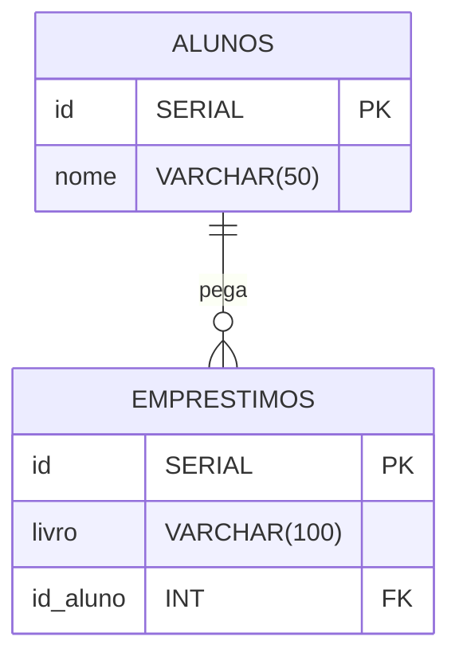

# Atividade Prática 10 - Relacionamento entre Tabelas (Biblioteca)
**Aluno:** Seu Nome Aqui  
**Professor:** Luiz Henrique Gonçalves Platini

---

## Diagrama de Relacionamento 



- **PK**: Chave Primária (Identificador único com incremento automático).
- **FK**: Chave Estrangeira (Vincula o empréstimo ao ID do aluno correspondente).

---

## MONTANDO O BANCO 

Abaixo estão os comandos SQL para criar o banco de dados, as tabelas com relacionamentos e realizar a inserção dos dados de teste solicitados (15 alunos e 10 empréstimos, deixando 5 alunos sem livros).

```sql
-- CRIANDO A TABELA DE ALUNOS
CREATE TABLE alunos (
    id SERIAL PRIMARY KEY,
    nome VARCHAR(50) NOT NULL
);

-- CRIANDO A TABELA DE EMPRÉSTIMOS
CREATE TABLE emprestimos (
    id SERIAL PRIMARY KEY,
    livro VARCHAR(100) NOT NULL,
    id_aluno INT REFERENCES alunos(id)
);

-- ADICIONANDO 15 ALUNOS
INSERT INTO alunos (nome) VALUES 
('Lucas'),      -- ID 1
('Victor'),     -- ID 2
('Nicollas'),   -- ID 3
('Ana'),        -- ID 4
('Beatriz'),    -- ID 5
('Carlos'),     -- ID 6
('Daniel'),     -- ID 7
('Eduardo'),    -- ID 8
('Fernanda'),   -- ID 9
('Gabriel'),    -- ID 10
('Helena'),     -- ID 11 (Sem livro)
('Igor'),       -- ID 12 (Sem livro)
('Julia'),      -- ID 13 (Sem livro)
('Karina'),     -- ID 14 (Sem livro)
('Leonardo');   -- ID 15 (Sem livro)

-- 4. ADICIONANDO 10 EMPRÉSTIMOS (Vinculados aos alunos de ID 1 a 10)
INSERT INTO emprestimos (livro, id_aluno) VALUES
('O Alquimista', 1),
('Dom Casmurro', 2),
('O Pequeno Príncipe', 3),
('Harry Potter e a Pedra Filosofal', 4),
('O Senhor dos Anéis', 5),
('1984', 6),
('A Menina que Roubava Livros', 7),
('O Hobbit', 8),
('Diário de um Banana', 9),
('Percy Jackson e o Ladrão de Raios', 10);
```

---

## PARTE 2 – CONSULTAS E RESPOSTAS

### 1) Mostre todos os dados de cada tabela
```sql
-- Ver todos os alunos cadastrados
SELECT * FROM alunos;

-- Ver todos os empréstimos registrados
SELECT * FROM emprestimos;
```

### 2) INNER JOIN: Nome do aluno e o livro que ele pegou
```sql
SELECT alunos.nome, emprestimos.livro
FROM alunos
INNER JOIN emprestimos ON alunos.id = emprestimos.id_aluno;
```
* **Resposta:** Os alunos **Helena, Igor, Julia, Karina e Leonardo** não apareceram.  
* **Por quê?** Porque o `INNER JOIN` só traz registros que possuem correspondência em **ambas** as tabelas. Como esses 5 alunos não pegaram nenhum livro emprestado, eles ficam de fora do resultado.

### 3) LEFT JOIN: TODOS os alunos e o livro de cada um
```sql
SELECT alunos.nome, emprestimos.livro
FROM alunos
LEFT JOIN emprestimos ON alunos.id = emprestimos.id_aluno;
```
* **Resposta:** Para quem não pegou nenhum livro, apareceu o valor **`NULL`** (vazio) na coluna `livro`.

### 4) Quem NUNCA pegou livro?
```sql
SELECT alunos.nome
FROM alunos
LEFT JOIN emprestimos ON alunos.id = emprestimos.id_aluno
WHERE emprestimos.id_aluno IS NULL;
```

### 5) Tenta registrar um empréstimo para o aluno 50
```sql
INSERT INTO emprestimos (livro, id_aluno) VALUES ('Turma da Mônica', 50);
```
* **Resposta:** O PostgreSQL gerou um **Erro de Violação de Chave Estrangeira (Foreign Key Constraint)**.  
* **Por quê?** O campo `id_aluno` possui uma restrição (`REFERENCES alunos(id)`). O banco de dados bloqueia a inserção porque o aluno de ID 50 **não existe** na tabela `alunos`, garantindo a integridade dos dados na biblioteca.


